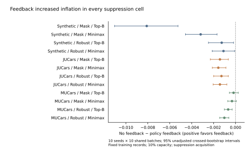
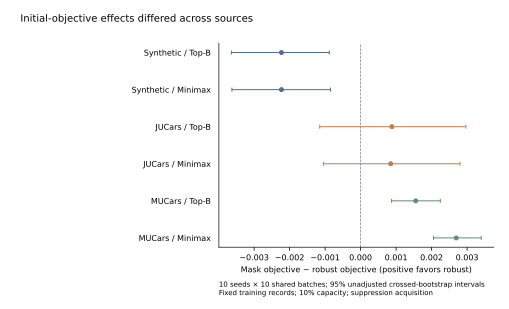

# 完整匹配因子结果与复核入口

[中文结果解读](../notes/factorial-final/RESULTS.zh.md) · [更新后的论文](../paper/innovation-addendum-v1.tex) · [主容量全部对比CSV](../notes/factorial-final/primary_contrasts.csv) · [各对比成分CSV](../notes/factorial-final/primary_components.csv)

[完整分析与审计包](../notes/factorial-final/audited-analysis-evidence.zip) 包含所有六容量的完整contrasts.csv、contrast_components.csv、cell_means_and_pareto.csv、64个对比定义、paired_tensors_and_draws.npz、输入绑定、统计快照和四阶段完成凭据。[EVIDENCE_INDEX.json](../notes/factorial-final/EVIDENCE_INDEX.json) 给出ZIP及每个原文件SHA256。ZIP展开后保留原analysis目录结构，勿把文件路径误当可直接在新机器使用。

## 主容量发现

10%预算下36/36反馈点估计增加inflation，34/36未校正区间全不利；MUCars 12/12 robust初始目标对比降低inflation并满足点门槛；联合反馈与minimax的18个对比无一通过门槛。没有多重比较校正，没有新训练总体不确定性，不能宣称通用优势或通用不可能性。

## 图与图源

Suppression acquisition，10%预算；点和线为no-feedback减policy-feedback的inflation效应及95%未校正种子×批次bootstrap区间。正值有利于反馈。两种初始目标和两种分配都保留。10种子共享同一1000个listing；固定训练记录。

Suppression acquisition、no-policy-feedback控制、10%预算；mask减robust初始目标的inflation差值，正值有利于robust。这里的mask/robust是新匹配实验训练目标，不是旧SAV/static-robust模型别名。区间同上。

每幅图均有PDF/SVG/PNG、source.csv和字体/碰撞QA。[报告构建脚本](../notes/build_factorial_final_report.py) 验证已完成分析哈希后生成结果与图；[图表依赖](../notes/factorial-final/requirements-report.txt)。主统计及审计代码仍为原冻结版本；没有重训练或新增性能数据。

## 尚未完成

图已独立交付，尚未嵌入单一完整投稿稿。创新首创性、作者声明、学校分区口径、许可、公开发布和清洁环境复现尚待处理。原逐条结果与模型文件不包含在此包中，不能据此声称任何外部机器已成功复现。
